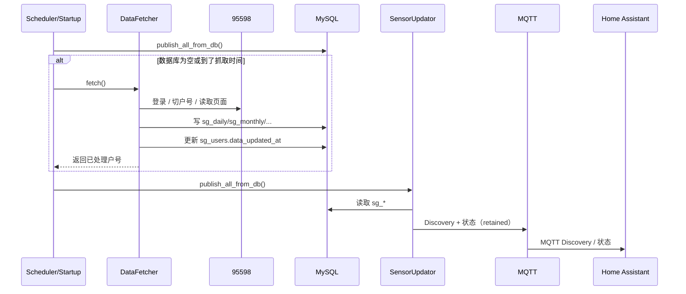

# 数据抓取、数据库与 HA 发布流程

本文档描述 `sgcc_electricity_new` 当前的完整流程：**抓取只负责写数据库，HA 只从数据库读取**。  
首次启动需要回补当年数据；日常只核对最近 7 天，每月 1 号抓上个月账单。

---

## 1. 整体架构

### 1.1 部署拓扑

支持三种运行方式，代码完全一致，区别只在配置来源和运行环境：

| 方式 | 配置来源 | 浏览器 | 数据目录 | 适用场景 |
|---|---|---|---|---|
| HA Add-on | Supervisor 写入 `/data/options.json` | 镜像内 Chromium/Chrome | `/data` | 正式部署 |
| Docker Compose | `.env` | 镜像内 Chromium/Chrome | `./:/data` | 本地验证 |
| 本地 Python | `.env` | 系统 Chrome + ChromeDriver | `./data` | 调试/首次回补 |

外部依赖：

```text
┌────────────────────┐        ┌────────────────────┐
│ Home Assistant     │        │ Mosquitto MQTT     │
│ homeassistant.local      │◀──────▶│ homeassistant.local:1883 │
└─────────┬──────────┘        └─────────┬──────────┘
          │ MQTT Discovery              │
          │                             │
┌─────────▼─────────────────────────────▼──────────┐
│ sgcc_electricity_new 运行实例                      │
│  - Selenium + Chrome                              │
│  - DataFetcher（抓取）                            │
│  - SensorUpdator（HA 发布）                       │
└─────────┬─────────────────────────────────────────┘
          │ MySQL
          ▼
┌────────────────────┐        ┌────────────────────┐
│ MySQL              │        │ 国家电网 95598      │
│ mysql.local/sgcc │        │ https://95598.cn   │
└────────────────────┘        └────────────────────┘
```

### 1.2 运行组件与职责

| 文件 | 职责 |
|---|---|
| `scripts/main.py` | 进程入口；加载配置；初始化日志/ErrorWatcher；启动调度；启动时优先从数据库发布；每 5 分钟从数据库重发 |
| `scripts/data_fetcher.py` | 抓取业务：登录、户号切换与校验、余额/年度/月度/日数据、官方账单、交费记录、阶梯快照、全年回补；只写数据库 |
| `scripts/db.py` | 数据模型与持久化：建表/迁移、upsert、官方优先级、年度汇总、阶梯计算、MySQL 重连、旧表迁移 |
| `scripts/sensor_updator.py` | HA 发布：`update_one_userid()` 组装实体状态；`publish_from_db()` / `publish_all_from_db()` 从数据库读取；余额通知 |
| `scripts/ha_mqtt.py` | HA MQTT Discovery：实体规格、设备信息、状态 JSON、`user_id`/`user_name` 属性、`serial_number` |
| `scripts/mqtt_publisher.py` | paho-mqtt 连接、重连、LWT、JSON 序列化、发布超时 |
| `scripts/vue_state.py` | 注入 JS 读取 95598 Vue 组件状态；账单/交费/阶梯规范化 |
| `scripts/captcha_selenium.py` | 腾讯点击/滑块验证码浏览器侧处理 |
| `scripts/click_captcha_solver.py` | 大模型识别点击验证码 |
| `scripts/onnx.py` | 本地验证码模型辅助 |
| `scripts/notify.py` | 二维码登录通知、余额不足推送 |
| `scripts/error_watcher.py` | 异常截图，保存到 `data/errors/` |
| `scripts/date_utils.py` | 日期/月份/时间/数字解析与统一格式 |
| `scripts/db_status.py` | 运维工具：查看数据库、修复当月/年度汇总、从数据库发布 HA；不访问国网 |
| `scripts/fetch_once.py` | 一次性完整抓取 + 从数据库发布；用于首次回补或人工验证 |
| `scripts/mock_publish.py` | 不访问国网的模拟 MQTT 实体，用于验证 HA Discovery |
| `scripts/probe_pages.py` | 页面结构探针，输出 Vue 状态和截图到 `data/probe/` |

### 1.3 模块依赖关系

```text
main.py
├─ data_fetcher.py
│  ├─ captcha_selenium.py / click_captcha_solver.py / onnx.py   登录验证码
│  ├─ vue_state.py                                             页面 Vue 状态
│  ├─ db.py                                                    写库
│  ├─ error_watcher.py                                         异常截图
│  ├─ date_utils.py                                            日期/数字解析
│  └─ notify.py                                                二维码/余额通知
└─ sensor_updator.py
   ├─ ha_mqtt.py                                               Discovery/状态
   ├─ mqtt_publisher.py                                        MQTT 连接
   └─ notify.py                                                余额通知

fetch_once.py  -> data_fetcher.py + sensor_updator.py + db.py
db_status.py   -> db.py + sensor_updator.py
mock_publish.py-> sensor_updator.py
probe_pages.py -> data_fetcher.py + vue_state.py
```

### 1.4 一次完整运行的时序



更细的步骤：

1. **启动**：`main.py` 先调用 `publish_all_from_db()`。数据库有数据就只发布，不访问国网；数据库为空才抓取。
2. **抓取**：`DataFetcher.fetch()` 启动 Chrome、登录、读取户号列表。
3. **逐户处理**：
   - 跳过 `IGNORE_USER_ID`；
   - 余额页切换户号并校验；
   - 读取余额、年度、月度、最近日数据；
   - `_save_user_data()` 写库并更新 `data_updated_at`；
   - `_sync_extras()` 按需回补全年、补官方账单、交费记录、阶梯快照。
4. **发布**：`SensorUpdator.publish_all_from_db()` 从数据库读取并发布 MQTT。
5. **重发**：之后每 5 分钟只从数据库重发一次，不访问国网。

### 1.5 调度矩阵

| 触发 | 动作 | 是否访问国网 |
|---|---|---|
| 进程启动 | 从数据库发布；数据库为空才抓取 | 仅数据库为空时 |
| 每天 `JOB_START_TIME`（默认 07:00，随机 ±10 分钟） | 日常抓取 + 发布 | 是 |
| 每天 `JOB_START_TIME + 12h` | 日常抓取 + 发布 | 是 |
| 每 5 分钟 | 从数据库重新发布 | 否 |
| 每月 1 号（随日常抓取） | 补上个月官方账单、交费记录、阶梯快照 | 是，仅一次 |
| 最近缴费超过 `PAYMENT_FETCH_INTERVAL_DAYS` | 同步交费记录 | 是 |
| 当年日数据覆盖不足 80% 或 `FORCE_YEAR_BACKFILL=true` | 全年日数据回补 | 是 |
| 手动 `fetch_once.py` | 一次性抓取 + 发布 | 是 |
| 手动 `db_status.py` | 查看/修复数据库、从数据库发布 | 否 |

调度原则：

- **HA 发布与抓取解耦**：即使抓取失败，HA 仍可从数据库重发旧数据。
- **日常抓取只核对最近 7 天**：历史数据已经在库里，不需要每天重复拉全年。
- **首次才全量**：只有首次、数据缺口大或显式 `--force-backfill` 才做全年回补。
- **1 号抓账单**：上个月账单通常 1 号后才出；未出时后续运行重试。

### 1.6 数据流与来源优先级

```text
95598 页面
  -> Selenium DOM / Vue state
  -> 规范化字段（date_utils / vue_state）
  -> MySQL upsert
  -> publish_from_db 读取
  -> MQTT Discovery + retained state
  -> Home Assistant 实体
```

来源优先级：

1. **official**：官方电费账单（`sg_monthly_bill` / `sg_monthly_usage`）；
2. **calculated**：页面月度值、日数据汇总；
3. **legacy**：旧版表迁移数据。

关键规则：

- 官方月度账单不会被 calculated 覆盖；
- 年度表由月度表重新汇总，不直接使用账单里的 `yearPq`；
- 当月阶梯使用当月日数据实时累加；
- 每个户号成功写库后更新 `sg_users.data_updated_at`。

### 1.7 故障处理与账号安全

| 场景 | 处理 |
|---|---|
| 登录失败 | 记录日志并返回；不无限重试，等待下一次定时任务 |
| 验证码/风控 | 按配置回退二维码；二维码通过 HA 通知或本地图片输出 |
| 页面加载慢/元素失效 | 数据页使用统一的 `PAGE_WAIT_TIME`；账单列表每次重新读取行元素 |
| 户号切换错误 | 优先按完整户号文本切换；切换后用 Vue state 校验；不一致则跳过 |
| MySQL 空闲断开 | 写库前 `ensure_connected()`，MySQL 用 `ping(reconnect=True)` |
| 账单详情无数据 | 不标记 official，避免错误覆盖月度表 |
| HA 发布失败 | 每个户号独立 try/except；MQTT 自动重连；失败不影响下次发布 |
| 页面异常 | `ErrorWatcher` 保存截图到 `data/errors/` |

账号安全：

- **不要反复手动重跑抓取**；频繁登录和账单详情访问会触发国网风控。
- 日常交给定时任务；排查优先用 `db_status.py`。
- `IGNORE_USER_ID` 中的户号完全不处理。
- 请求之间保留随机延迟；每日抓取次数固定。
- 密码不写入文档、不提交 git；日志中的密码已打码。

### 1.8 多户号与多用户

- 每个户号对应一个 HA 设备，设备标识 `sgcc_electricity_<完整户号>`。
- 实体 ID 风格由 `ENTITY_ID_STYLE` 控制：
  - `none`（默认）：`sensor.last_electricity_usage`，不带户号后缀，适合只启用一个户号；
  - `full`：`sensor.last_electricity_usage_<完整户号>`，多户号时保证唯一；
  - `last4`：`sensor.last_electricity_usage_<后4位>`，兼容旧版实体。
- 所有实体状态 JSON 带：
  - `user_id`：完整户号；
  - `user_name`：`USER_NAMES` 中的友好名称。
- 设备详情 `serial_number` 也是完整户号，便于在 HA 中筛选。
- `IGNORE_USER_ID` 控制不抓取/不推送的户号；`USER_NAMES` 只负责命名，不改变抓取范围。
- 从 `last4` 切换到其它风格时，`CLEANUP_LEGACY_ENTITY_IDS=true` 会自动删除旧的后 4 位 MQTT Discovery 配置。

### 1.9 扩展点与限制

扩展点：

- **新增实体**：在 `ha_mqtt.py` 的 `SENSOR_SPECS` 增加规格，在 `sensor_updator.py` 发布状态。
- **新增数据表/字段**：在 `db.py` 的 `_create_schema` 增加，并用 `_ensure_column` 兼容旧库。
- **新增页面抓取**：在 `data_fetcher.py` 增加页面方法，并在 `_sync_extras()` 中按调度条件调用。
- **新增计算**：在 `db.py` 增加查询/汇总方法，并补测试。
- **新增配置**：同时更新 `config.yaml` 的 `options`/`schema` 和 `example.env`。

已知限制：

- 依赖 95598 页面 DOM/Vue state，页面改版可能需要调整选择器。
- 官方账单有发布延迟；未出账单时月度实体显示 calculated 数据。
- 当月电费在账单出之前无法准确获得，只能实时算电量/阶梯。
- 单个进程串行抓取，不支持并发。
- HA 发布完全依赖数据库；数据库为空时不会凭空生成实体。

---

## 2. 数据库表

| 表 | 用途 |
|---|---|
| `sg_users` | 户号基本信息、友好名称、`data_updated_at`（最后一次成功写库时间） |
| `sg_daily_usage` | 日用电量，含谷/平/峰/尖、电费、数据来源 |
| `sg_monthly_usage` | 月度用电量/电费，`source=official/calculated/legacy` |
| `sg_yearly_usage` | 年度汇总，由月度表重新汇总（`refresh_yearly_from_monthly`） |
| `sg_balance_log` | 余额历史，含 `amount_due`、`as_of` |
| `sg_payments` | 交费记录，按户号+缴费时间+金额+渠道去重 |
| `sg_monthly_bill` | 官方月账单快照，含分时电量、年度累计、阶梯字段、账单周期 |
| `sg_tier_snapshot` | 官方阶梯快照，含 `levelFlag`、`oneLevelPq`、`twoLevelPq`、`laddernum` |

数据保留：

- `DATA_RETENTION_DAYS=0`（默认）时永久保留日数据和余额历史。
- 月度、年度、交费、账单、阶梯表不会自动清理。

---

## 3. 抓取流程

### 3.1 登录与户号选择

入口：`DataFetcher.fetch()` → `fetch_with_driver()`。

1. 打开 `https://95598.cn/osgweb/login` 并登录（密码/验证码，失败时按配置回退二维码）。
2. `_get_user_ids()` 从页面下拉读取 13 位户号列表。
3. 遍历户号：
   - 户号在 `IGNORE_USER_ID` 中：直接跳过，不抓取、不写库、不推送 HA。
   - 否则在余额页调用 `_choose_current_userid()`：
     - 优先按完整户号文本匹配；
     - 页面只显示后 4 位/名称时回退按索引点击；
     - 点击后用 `_get_page_user_id()` 校验 Vue state 中的 `consNo` / `consNo_dst` / `consNoDst`。
   - 校验不一致会重试切换；仍不一致则跳过，避免把 A 户号数据写到 B 户号。
4. `USER_NAMES` 中的友好名称用于 `sg_users.user_name`、HA 设备名和实体 `user_name` 属性。

### 3.2 日常数据抓取（每次定时任务）

`_get_all_data()`：

1. 余额页：读取余额和增强余额（`amount_due` / `as_of`）。
2. 用电量页：
   - 年度用电量/电费（页面值）。
   - 月度用电量/电费（页面月度表）。
   - 最近一次日用电量。
   - 当前页面 Vue state 的分时数据（日/月）。
   - 最近 `DAILY_FETCH_DAYS`（默认 7）天日数据。
3. `_save_user_data()`：
   - 写 `sg_balance_log`。
   - 写 `sg_daily_usage`：只保留最近 `DAILY_RECONCILE_DAYS`（默认 7）天，避免每天重复写全年。
   - 写 `sg_monthly_usage`：页面月度值，`source=calculated`。
   - 写 `sg_yearly_usage`：页面年度值，`source=calculated`。如果年度表已有 official 行，不会被 calculated 覆盖。
   - `touch_user_data()` 更新 `sg_users.data_updated_at`。

> 注意：日常抓取不会删除历史数据。最近 7 天只是“核对/覆盖”，全年历史仍在库里。

### 3.3 首次全年回补

`_sync_extras()` 中调用 `_year_backfill_needed()`：

- 当年日数据覆盖不足约 80%，或 `FORCE_YEAR_BACKFILL=true` 时触发。
- `_backfill_year()` 按 `YEAR_BACKFILL_CHUNK_DAYS`（默认 90 天）分段：
  1. 打开用电量页，切换到日用电量 tab。
  2. 找到带 `getdata()` / `sevenEleList` / `start` / `end` 的 Vue 组件。
  3. 设置 `start`/`end`，调用 `getdata()`，等待 `sevenEleList` 返回。
  4. 写 `sg_daily_usage`。
- 回补结束后：
  - 对涉及的月份调用 `sync_calculated_month_from_daily()`；
  - 调用 `refresh_yearly_from_monthly()` 重算年度表；
  - 在当前进程内标记该年已回补，避免同一次运行反复回补。

一次性执行方式：

```bash
python scripts/fetch_once.py --force-backfill
```

### 3.4 每月 1 号：上个月官方账单

`_missing_bill_months()`：

- 计算从当年 1 月到“上个月”的月份列表；
- 1 月 1 日额外补上上一年 12 月；
- 用 `has_official_bill()` 判断是否已有官方账单；
- `BILL_SYNC_MAX_MONTHS` 限制单次最多补查月份数。

`_sync_bill_months()`：

1. 余额页先切换到目标户号（账户下拉最稳定）。
2. 打开 `https://95598.cn/osgweb/electricitySummary`。
3. 选择账单年份，点击“查看更多”展开月份。
4. 逐月：
   - 每次重新读取 `billList_content` 行（`driver.back()` 后页面重绘，旧行元素会失效）；
   - 点击行内箭头打开详情；
   - 从 Vue state 解析 `billList` / `nowBillList` / `basicInfo` / `pvQtyList` / `prcGroupList`；
   - 写 `sg_monthly_bill`（官方账单快照）；
   - 写 `sg_monthly_usage`（`source=official`）；
   - 调用 `refresh_yearly_from_monthly()` 重算年度表；
   - `driver.back()` 返回列表。
5. 账单未出时该月仍缺失，后续运行会重试。

账单字段包括：

- 本月电量/电费（`monthPq` / `monthAmt`）
- 年度累计（`yearPq` / `yearAmt`，仅作账单快照，不直接写年度表）
- 谷/平/峰/尖（`valQty` / `flatQty` / `peakQty` / `sharpQty`）
- 阶梯（`levelFlag` / `oneLevelPq` / `twoLevelPq` / `totalYearPq` / `totalMonthPq` / `yearUsedPq` / `laddernum`）
- 账单周期（`begDate` / `endDate` / `issuDate`）

### 3.5 交费记录

`_get_payment_records()`：

- 打开 `https://95598.cn/osgweb/paymentRecord`。
- 等待 `payLists` 和 `mixinGetYuEdata` 加载。
- 设置查询区间（默认去年 1 月 1 日至今）和条数，调用页面 `getSearchRecords()`。
- 解析 `payDate` / `rcvAmt` / `payModeName` / `totalRepAmt` 等字段。
- 写 `sg_payments`，按 `(user_id, pay_date, amount, pay_mode)` 去重。
- HA 推送 `last_payment_amount`、`last_payment_date`。

同步时机：

- 每月 1 号；
- 数据库中没有交费记录；
- 最近一次缴费时间超过 `PAYMENT_FETCH_INTERVAL_DAYS`（默认 7 天）。

### 3.6 官方阶梯快照

`_get_tier_snapshot()`：

- 打开 `https://95598.cn/osgweb/stepElectricityConsumption`。
- 从 Vue state 读取 `stepObj`（`electricParticulars`）、`other`、`userD`、`soc`。
- 保存 `levelFlag`、`oneLevelPq`、`twoLevelPq`、`totalYearPq`、`totalMonthPq`、`yearUsedPq`、`laddernum`。
- 写 `sg_tier_snapshot`。

同步时机：

- 每月 1 号；
- 没有快照；
- 快照月份不是当前月。

日常阶梯状态不依赖该页面，直接由数据库动态计算（见第 4 节）。

### 3.7 MySQL 连接稳定性

抓取过程中页面操作可能持续十几分钟，MySQL 连接可能被服务端断开。写库前统一调用：

```python
db.ensure_connected(user_id)
```

- MySQL：`ping(reconnect=True)`；
- SQLite：`SELECT 1`；
- 失败时重新 `connect_user_db()`。

---

## 4. 年累计与阶梯计算口径

### 4.1 年累计

`sg_yearly_usage` 不再直接使用账单里的 `yearPq`，而是：

```text
年度累计 = Σ 当年各月 sg_monthly_usage.total_usage
```

月度表优先级：

1. `official` 官方账单；
2. `calculated` 页面月度值；
3. `legacy` 旧数据。

当月月度值如果还没有官方账单，会由 `sync_calculated_month_from_daily()` 用当月日数据刷新。

当前示例：

```text
1 月 official  29.00
2 月           1.00
3 月           3.00
4 月           3.00
5 月          11.00
6 月         133.00
7 月         138.00
8 月         118.00
9 月         131.00
10 月（1-20 日实时）216.26
──────────────────────
年累计         783.26
```

### 4.2 阶梯实时计算

`DB.get_tier_state()`：

```text
历史月份用量 = Σ 1 月 ~ 上个月 sg_monthly_usage.total_usage
当月用量     = 当月 1 日 ~ 今天 sg_daily_usage.total_usage
年度累计     = 历史月份用量 + 当月用量
```

默认边界：

| 阶梯 | 范围 |
|---|---|
| 第一阶梯 | 0 - 2160 |
| 第二阶梯 | 2161 - 4200 |
| 第三阶梯 | 4201 以上 |

返回字段：

- `tier`：1/2/3
- `tier_name`：第一/二/三阶梯
- `range_label`：`0-2160` / `2161-4200` / `4201以上`
- `previous_months_usage`
- `current_month_usage`
- `total_usage`
- `remaining_usage`
- `progress_percent`
- `thresholds`

当前示例：

```text
历史月份 567.00 + 当月 216.26 = 783.26
→ 第一阶梯，剩余 2160 - 783.26 = 1376.74
```

> 页面“本年电量”显示 556 的原因：页面年度值还没包含 10 月实时用电，且 1 月页面月度值是 18 度而官方账单是 29 度。  
> 数据库的年累计按月度表 + 当月日数据计算，所以是 783.26。

---

## 5. HA 发布流程

### 5.1 从数据库发布

`SensorUpdator.publish_from_db(user_id, db)`：

1. `db.connect_user_db(user_id)`。
2. 读取：
   - `sg_users`（名称、`data_updated_at`）
   - `sg_balance_log` 最新余额
   - `sg_daily_usage` 最新日数据
   - `sg_monthly_bill` 上个月官方账单（如果有）
   - `sg_monthly_usage` 上个月/当月月度汇总
   - `sg_yearly_usage` 年度汇总（缺失时用月度表求和）
   - `sg_payments` 最近一次缴费
   - `db.get_tier_state()` 实时阶梯
   - `sg_tier_snapshot` 最新官方阶梯快照
3. 组装成 `update_one_userid()` 需要的参数。
4. 发布 MQTT Discovery 和状态。

`publish_all_from_db(db)`：

- `connect_users_db()` 列出 `sg_users` 中的所有户号；
- 对每个户号调用 `publish_from_db()`。

### 5.2 实体列表

| 实体 | 说明 |
|---|---|
| `electricity_charge_balance` | 电费余额 |
| `prepay_balance` | 预付费余额/应交金额 |
| `last_electricity_usage` | 最新日电量 |
| `last_valley/flat/peak/tip_electricity_usage` | 最新日分时电量 |
| `yearly_electricity_usage/charge` | 本年电量/电费 |
| `month_electricity_usage/charge` | 最近一个月（优先官方账单） |
| `month_valley/flat/peak/tip_usage` | 月度分时电量 |
| `last_payment_amount` | 上次缴费金额 |
| `last_payment_date` | 上次缴费时间（timestamp） |
| `current_electricity_tier` | 当前阶梯（1/2/3） |
| `current_tier_usage` | 年度累计电量 |
| `current_tier_remaining` | 当前阶梯剩余电量 |
| `data_updated_at` | 数据更新时间（timestamp） |

所有状态 JSON 都包含：

```json
{
  "state": "...",
  "user_id": "1234567890123",
  "user_name": "家庭用电"
}
```

设备详情中的 `serial_number` 也是完整户号，便于按户号筛选/展示。

### 5.3 发布时机

- `main.py` 启动时：先从数据库发布；数据库没有数据才抓取。
- 每天 `JOB_START_TIME`（默认 07:00，随机 ±10 分钟）和 12 小时后各抓取一次。
- 每 5 分钟：只从数据库重发一次，不访问国网。
- 抓取完成后：`run_task()` 调用 `publish_all_from_db()`。
- 数据库为空时：`republish_or_fetch()` 会触发一次抓取。

---

## 6. 调度与配置

| 配置 | 默认 | 说明 |
|---|---|---|
| `JOB_START_TIME` | `07:00` | 每日抓取时间，另加 12 小时一次 |
| `DAILY_FETCH_DAYS` | `7` | 页面日数据抓取窗口 |
| `DAILY_RECONCILE_DAYS` | `7` | 日常写库只核对最近 N 天 |
| `PAYMENT_FETCH_INTERVAL_DAYS` | `7` | 交费记录同步间隔（1 号总会同步） |
| `BILL_SYNC_MAX_MONTHS` | `12` | 单次最多补查月份 |
| `YEAR_BACKFILL_ENABLED` | `true` | 是否允许首次全年回补 |
| `YEAR_BACKFILL_CHUNK_DAYS` | `90` | 全年回补分段天数 |
| `FORCE_YEAR_BACKFILL` | `false` | 强制重新回补当年日数据 |
| `TIER1_MAX` / `TIER2_MAX` | `2160` / `4200` | 阶梯边界 |
| `PAGE_WAIT_TIME` | `10` | 数据页操作等待秒数 |
| `ENTITY_ID_STYLE` | `none` | `none` 无后缀 / `full` 完整户号 / `last4` 旧版后4位 |
| `CLEANUP_LEGACY_ENTITY_IDS` | `true` | 切换风格时清理旧后4位 MQTT 实体 |
| `DATA_RETENTION_DAYS` | `0` | 0=永久保留 |
| `IGNORE_USER_ID` | - | 跳过不抓取的户号 |
| `USER_NAMES` | - | 户号友好名称 |

---

## 7. 运维与排查

只读查看（不访问国网）：

```bash
python scripts/db_status.py --user-id 1234567890123
```

修复当月月度/年度汇总（只写数据库）：

```bash
python scripts/db_status.py --user-id 1234567890123 --repair
```

从数据库发布 HA（只发 MQTT）：

```bash
python scripts/db_status.py --user-id 1234567890123 --publish
```

一次性完整抓取（会访问国网，建议只在首次或明确需要时执行）：

```bash
python scripts/fetch_once.py --force-backfill
```

> ⚠️ 不要反复手动重跑抓取。登录、账单详情、交费页都会触发国网风控；日常交给定时任务即可。

---

## 8. 当前数据状态（2026-10-21）

户号 `1234567890123`：

- `sg_daily_usage`：293 条，`2026-01-01 ~ 2026-10-20`。
- `sg_monthly_usage`：10 条（1 月 official，2-10 月 calculated）。
- `sg_monthly_bill`：目前只有 2026-01 官方账单。
- `sg_payments`：0 条（上一轮抓到 13 条但因 MySQL 长连接断开未写入，`ensure_connected` 已修复）。
- `sg_tier_snapshot`：0 条（`/stepElectricityConsumption` 尚未成功落库）。
- `sg_yearly_usage`：783.26 度 / 340.2 元（已从月度表修复）。
- `data_updated_at`：`2026-10-21 13:41:35`。
- 实时阶梯：第一阶梯，累计 783.26 度，剩余 1376.74 度。

待补：

- 2-9 月官方账单；
- 交费记录；
- 官方阶梯快照。

以上三项需要**一次**受控抓取，代码修复已就绪（账单行元素重读、MySQL 重连、余额页预切户号、`listData.consNoDst` 校验），但不会自动重跑。
